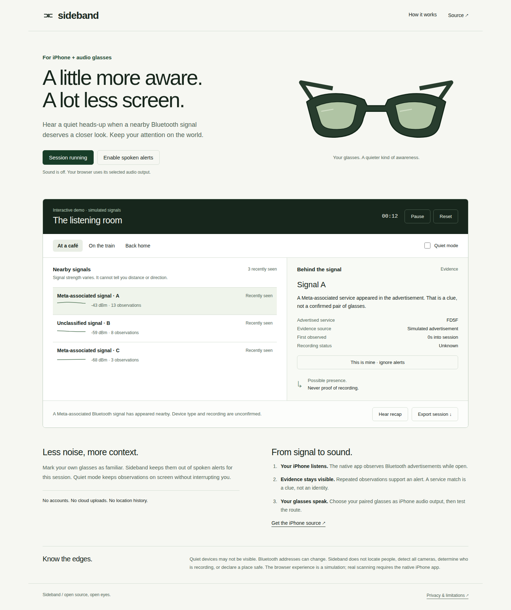

# Sideband

**A little more aware. A lot less screen.**

An iPhone listening companion for Bluetooth audio glasses, with a polished interactive browser demo. Sideband observes nearby Bluetooth advertisements, explains the evidence behind a service match, and can read a brief heads-up through your chosen headphones or glasses.

[Try the interactive demo](https://rishvaiyer.github.io/sideband-glasses/) · [Privacy](docs/PRIVACY.md) · [Architecture and limitations](docs/ARCHITECTURE.md) · [Verification](docs/VERIFICATION.md)



## What you can try

- Three replayable environments: café, train and home.
- Evidence view with service UUID, recent signal strength and observation count.
- Familiar-device muting and quiet mode.
- Spoken heads-ups with repetition and burst suppression.
- Session recap and local JSON export.
- Native iPhone foreground BLE scanning, with explicit permission and audio-route checks.

The browser demo uses **simulated advertisements**. It does not scan Bluetooth, connect to glasses or identify your audio hardware. Its speech follows your device's selected output. The native app observes real BLE advertisements, but the physical iPhone/glasses path must be tested before claiming device compatibility.

## iPhone app

The SwiftUI app lives in `ios/`. Its core has no third-party dependencies and uses CoreBluetooth and AVSpeechSynthesizer. Standard iOS Bluetooth audio is sufficient for this version; there is no Meta login, camera capture or Meta SDK dependency. This is an independent app, not a Meta product or approved integration.

Requires iOS17 or later. Generate the project on a Mac with Xcode and XcodeGen:

```sh
brew install xcodegen
xcodegen generate --spec ios/project.yml --project ios
open ios/Sideband.xcodeproj
```

For a simulator, build with code signing disabled. For your iPhone, select your own development team and a unique bundle identifier, and set `CODE_SIGNING_ALLOWED=YES` for that device build. Signing credentials are never included. Pair your glasses through their supported phone setup, choose them as audio output, and use **Play audio check**. Then choose **iPhone Bluetooth** and start listening. Keep the app open; this version stops scanning when inactive. No camera or microphone permission is needed.

CI builds an unsigned simulator app. That artifact is **not an installable iPhone IPA**. Apple signing and an on-device build are required for physical installation; this repository does not claim App Store or TestFlight availability.

## Demo development

```sh
npm ci
npm test
npm start
```

Open `http://localhost:4178`. Browser tests use Node22+ and Playwright (`npm run test:ui`). On a fresh machine install its browser with `npx playwright install chromium`. Swift core checks: `swift test`.

## What a match means

The initial rule recognizes the Bluetooth service UUID `FD5F`, assigned to Meta Platforms Technologies. It is deliberately labeled **Meta-associated**, not confirmed glasses. A service identifier can be shared, absent or spoofed. The app cannot determine recording, device ownership, distance, direction or whether an area is safe. Repeated observations reduce notification noise; they do not turn a heuristic into verified identity.

Inspired by the evidence-first part of the Eye Spy workflow. This is a separate implementation with a narrower iPhone-compatible scope, not a port of the ESP32 firmware or a claim to all its detectors. See [sources](docs/SOURCES.md).

## Repository names considered

**Sideband** (`sideband-glasses`) was selected for the secondary, quiet information channel. Alternatives: **Hushfield** (`hushfield`) and **Nearnote** (`nearnote-glasses`). These are project names, not trademark-clearance claims.

MIT licensed. No accounts, telemetry, API keys, location collection or cloud processing in the app.
